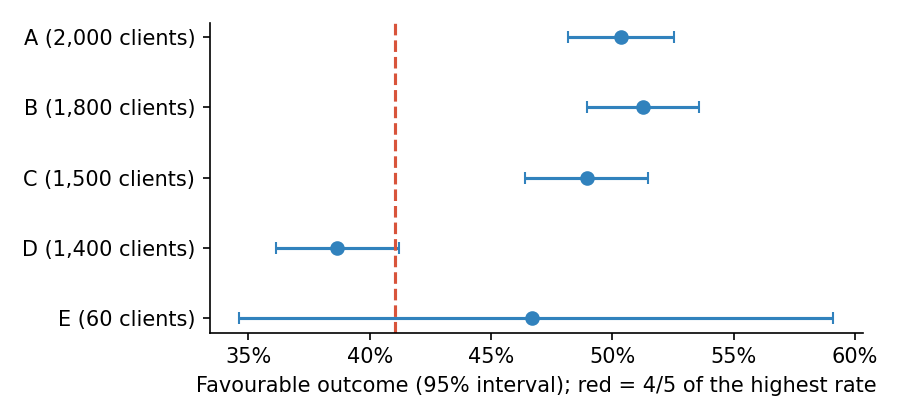
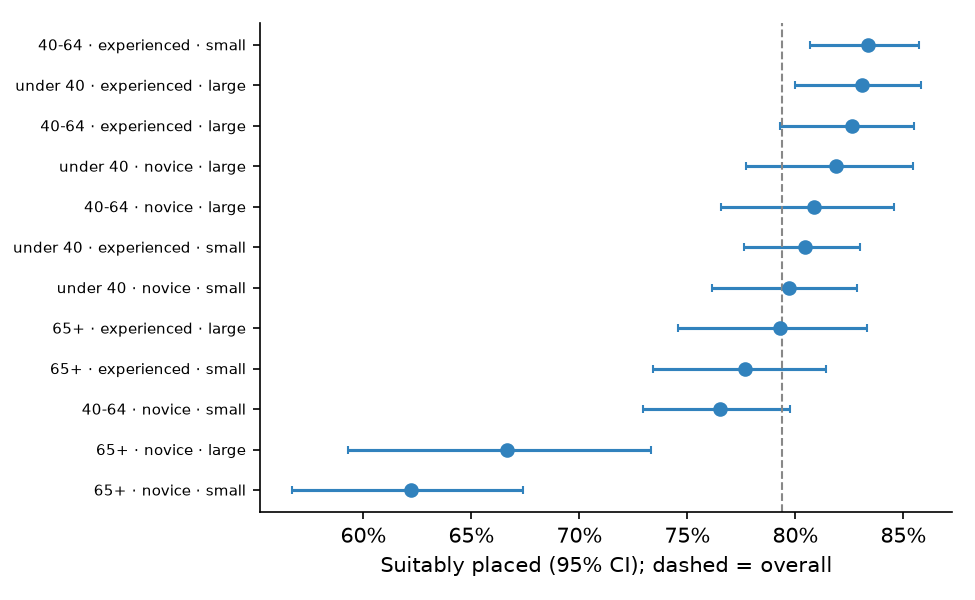

# Fair treatment of clients

> Public sources only; full references in [SOURCES.md](../SOURCES.md). Every
> number quoted below comes from the simulated data in
> [05-illustrations](../05-illustrations/), not from any real firm.

## Why this lens

An adviser's duty of loyalty includes not unfairly favouring one client over
another (SEC Release IA-5248). A scoring or placement model applies the same logic to
everyone, which can look like a guarantee of fairness. It is not. The same
logic can rely on an input that stands in for a protected characteristic,
measure some clients less accurately than others, or serve one combination of
clients badly while every average looks fine. NIST AI RMF MEASURE 2.11 asks
for fairness and bias to be evaluated and the results documented, but it does
not say how.

The research below supplies the how. It also makes a second point that shaped
these tests: **a fairness test can itself be badly designed.** Groups picked
after seeing the data, samples too small to detect anything, or gaps reported
without context can each produce a misleading pass or a misleading fail.

## What I read, and what each source changed

| Source | The idea I took from it | What it changed in the tests |
|---|---|---|
| Kusner et al. (2017), *Counterfactual Fairness* | A decision is fair to an individual if it would be the same had their protected attribute been different. | Twin clients that differ in one attribute only (F1) |
| EEOC et al. (1978), *Uniform Guidelines*, 29 CFR 1607.4(D) | The four-fifths rule is a screen. The same section warns that small numbers can make large differences meaningless, and that statistical significance matters. | Four-fifths paired with a significance test and a power check (F2) |
| Buolamwini & Gebru (2018), *Gender Shades* | Commercial classifiers looked accurate overall but erred far more for one intersectional group. | Intersectional cells, with the worst group reported beside the average (F3, G1) |
| Barocas et al. (2021), *Designing Disaggregated Evaluations* | Choices about which groups, which metrics, what to adjust for, and how to handle uncertainty decide what an evaluation can show. | Raw and adjusted disparity side by side (F4); pre-registered groups; multiple-testing control (F3, S2) |
| Grable & Lytton (1999), *Financial Risk Tolerance Revisited*; Cronbach (1951) | A risk-tolerance questionnaire is a measurement instrument, and its reliability can be tested. | Reliability of the questionnaire by client group (F5) |
| Wilson (1927); Benjamini & Hochberg (1995) | Honest intervals for proportions, including small ones; controlling false discoveries when many groups are compared. | Used throughout F1 to F3 |

The four-fifths rule comes from employment law, not investment regulation. I
use it as a widely understood screening threshold, not as a legal standard
for advisers.

## The tests

Pass criteria are written as *how to set them*. For fairness the groups,
control factors and thresholds are fixed **before** the data is examined.
Anything chosen afterwards is labelled exploratory (F7).

---

### F1. Counterfactual twin clients

**Principle.** If changing only a client's protected attribute changes the
recommendation, that attribute is affecting the advice directly (Kusner et
al., 2017).

**Objective.** Show, without needing to see the model's internals, whether
any attribute that should not matter changes the recommendation.

**Client harm.** Two clients with identical answers receive different
portfolios because of where they live, or their sex.

**Why existing tests miss it.** Reviews check which inputs the model is
*documented* to use. A twin test checks what the model actually does,
including proxies such as region that nobody listed as protected.

**Data.** A set of client records and the ability to run the scoring model on
records the validator has edited. Real client records are best, because they
carry the real mix of answers; realistic synthetic personas work when real
records cannot be used. Two lists are agreed with compliance first:

- **Attributes that must not matter:** protected characteristics, and inputs
  that could stand in for them, such as postcode, region or first language.
- **Attributes that may legitimately matter:** age and time horizon, for
  example. These are still tested, but against the documented rule rather
  than against zero.

If the model can only be reached through a client-facing system, the twins
are submitted through that system, so that any adjustment made outside the
scoring model is caught too.

**Method.**
1. For each client, create one twin per alternative value of the attribute
   under test (each sex, each region), leaving every questionnaire answer and
   every other input unchanged.
2. Run the model on the original and on each twin, and record the
   recommended risk band each time.
3. For each attribute value, count the share of clients whose band changes,
   with a 95% Wilson interval. Only clients whose value actually changed are
   counted, so that "setting region to east" is measured on clients who were
   not already in the east.
4. Where a change appears, look at which clients move. Changes clustered just
   below or above a band boundary show the attribute nudging the score; a
   large jump shows a rule that overrides the score.
5. Repeat with the same random seed, or several times, if the model has any
   random element, so that a change caused by randomness is not mistaken for
   a change caused by the attribute.

**Setting the pass criteria.**
- **Attributes that must not matter:** the expected rate of change is zero.
  A tolerance is agreed only if the model has a documented random element,
  and then it is set from repeated runs of the unedited records.
- **Attributes that may legitimately matter:** the observed changes must
  match the documented rule, in direction and size. A model documented to
  lower risk for clients near retirement should move those clients down, and
  only those clients.
- **Undocumented effects:** any attribute that changes the recommendation and
  is not documented as a suitability factor is a finding, whatever its size.
  It goes to the model owner to explain or remove.

**What the illustration shows.** The script simulates 4,000 clients who each
answer eight questions on a 1–5 scale. Two stand-in scoring rules turn the
answers into a 0–100 score and then into one of five risk bands:

- the first uses the answers only;
- the second adds a hidden regional adjustment: 4 points off for clients in
  the south, 3 points added in the west.

| Rule | Attribute changed | Clients whose band changes |
|---|---|---|
| Answers only | Sex, or any region | 0.0% (upper bound of the interval 0.1–0.2%) |
| With regional adjustment | Sex | 0.0% |
| With regional adjustment | Region set to east, or to north | 11.9% (about 11–13%) |
| With regional adjustment | Region set to west | 21.2% (19.8–22.7%) |
| With regional adjustment | Region set to south | 29.0% (27.5–30.7%) |

East and north carry no adjustment, so moving a client there only removes
the adjustment they had. The share that changes band is the share of clients
whose score sat close enough to a band boundary for 3 or 4 points to matter.
The test finds the regional rule without any access to the code, and sizes
its effect.
[`f1_counterfactual_twins.py`](../05-illustrations/f1_counterfactual_twins.py)

**Limitation, stated plainly.** Flipping one attribute while holding the rest
fixed only catches *direct* use. Full counterfactual fairness also follows
the attribute's influence through other inputs that depend on it, which needs
a causal model. That is why F2 to F4 look at outcomes as well.

**Adjacent tests.**
- **F2 to F4** look at outcomes by group, which also captures indirect
  effects that a twin test cannot see.
- **O1** checks whether any single input, documented or not, dominates the
  recommendation; a proxy found here often shows up there too.
- **F6** traces where in the pipeline an effect enters, for example in the
  score or in a later override.

**Regulatory hook.** Duty of loyalty, not unfairly favouring one client over
another (IA-5248).
**NIST AI RMF.** MEASURE 2.11.

---

### F2. Adverse impact with honest statistics

**Principle.** A group whose favourable-outcome rate is below four-fifths of
the best group's rate is flagged as possible adverse impact. The Uniform
Guidelines themselves say small differences can matter where significant, and
large ones may not where numbers are small.

**Objective.** Screen every pre-agreed group for adverse impact, test whether
the differences are real, and say which groups are too small to judge.

**Client harm.** A group is quietly given less access to growth portfolios.
Or a small group is reported as treated fairly when the test had no chance of
detecting a problem.

**Why existing tests miss it.** A ratio on its own produces both errors. It
flags noise in small groups and passes them when they are too small to fail.

**Data.** One row per client in the review period, holding the model's
outcome for that client and the groups they belong to. Three things need
agreeing before any data is pulled:

- **The favourable outcome.** It has to be something that benefits the
  client, defined with the model owner. Here it is being offered a growth
  portfolio. A growth portfolio is not good for every client, which is why
  F2 is a first screen; differences that legitimate needs explain are handled
  in F4.
- **The groups.** Advisers often don't record protected characteristics.
  Where they don't, the validator either agrees a proxy method with
  compliance, or tests on characteristics the firm does hold. Age is the
  obvious one, and it matters for senior-investor rules.
- **The period.** It should be long enough that the smallest groups have
  usable numbers. Group sizes go into the record before any outcome is looked
  at, because they decide what the test can and cannot show.

The basic checks before analysis:
- the share of clients with no group recorded, reported rather than silently
  dropped;
- duplicate clients;
- clients who moved group during the period, such as crossing an age band.

**Method.**
1. **Outcome rate per group, with a 95% Wilson interval.** The textbook
   interval (rate ± 1.96 standard errors) behaves badly for small groups and
   for rates near 0 or 1, and can even go below zero. The Wilson interval
   stays between 0 and 1 and keeps close to its stated coverage. Report the
   count, the number with the favourable outcome, the rate and the interval
   for each group.
2. **Impact ratio.** Each group's rate divided by the highest group's rate;
   below 0.8 is flagged. The reference group is agreed in advance. If the
   best-treated group is itself small, its rate is noisy and every ratio
   inherits that noise, so the ratio against the overall rate is shown
   alongside.
3. **A test of whether the rates really differ.** A chi-square test on the
   full group-by-outcome table asks whether any difference is larger than
   chance. Each flagged group is then compared with the reference group
   directly: a two-proportion test, or Fisher's exact test when the counts
   are small. Those comparisons are adjusted for the number made (S2).
4. **Power.** For each group, work out the smallest gap the test could
   reliably detect: 80% power at the 5% level, given that group's size, the
   size of everyone else and the overall rate. If that smallest detectable gap
   is larger than the gap agreed to matter, a "pass" means nothing, because a
   problem of that size could be hiding.
5. **One table for the report:** group, clients, rate and interval, impact
   ratio, p-value, smallest detectable gap, and the verdict.

**Setting the pass criteria.** The criteria are agreed with the model owner
and compliance before the outcomes are seen, which makes the result
confirmatory rather than exploratory (F7). Each group gets one of three
verdicts:

- **Flag:** an impact ratio below 0.8 *and* a difference that is
  statistically significant after adjustment. Flagged groups go to F4, to see
  whether legitimate factors explain the gap, and then to F6, to see where in
  the pipeline it arises.
- **Pass:** the ratio is at or above 0.8, or the difference is not
  significant, *and* the group is large enough to have detected a gap that
  matters.
- **Inconclusive:** the group is too small to judge. The report says so,
  together with what would settle it: pooling more periods, reviewing those
  clients' files by hand, or waiting for more clients.

The gap that matters (here, 10 percentage points) is a judgement about client
outcomes: how large a difference in access would make a real difference to
what clients end up holding. It is usually set tighter for groups the
regulator watches most closely, such as older clients.

The four-fifths rule itself comes from US employment-selection guidance
(1978). For advisers it is a widely used screening convention, not a legal
test, which is another reason it is paired with statistics here.

**What the illustration shows.** The script simulates 6,760 clients in five
groups with known true rates of access to growth portfolios:
- groups A, B and C are similar, at 49–51%;
- group D is genuinely lower, at 37%;
- group E is small, only 60 clients, with a true rate of 42%.

| Group | Clients | Observed rate (95% interval) | Impact ratio | Smallest detectable gap | Verdict |
|---|---|---|---|---|---|
| A | 2,000 | 50.3% (48.2–52.5) | 0.98 | 3.7 points | Pass |
| B | 1,800 | 51.3% (49.0–53.6) | 1.00 (reference) | 3.9 points | Pass |
| C | 1,500 | 48.9% (46.4–51.5) | 0.95 | 4.1 points | Pass |
| D | 1,400 | 38.6% (36.1–41.2) | 0.75 | 4.2 points | **Flag** |
| E | 60 | 46.7% (34.6–59.1) | 0.91 | 18.1 points | **Inconclusive** |

The chi-square test confirms the rates are not all equal (p ≈ 10⁻¹²).

- **Group D:** the rule works as intended. The ratio is below 0.8, the
  interval sits well below group B's, and with 1,400 clients the test could
  have detected a gap of about 4 points.
- **Group E:** the rule misleads. Its ratio of 0.91 "passes", but its
  interval runs from 35% to 59%, wide enough to include both D's disadvantage
  and full parity. Its true rate is 8 points below groups A to C, a real
  disadvantage that the ratio alone would have passed.

The smallest-detectable-gap column is what separates the two cases.

*Each dot is a group's rate with its 95% interval; the red line is
four-fifths of the highest rate. D sits clearly to the left of it. E's
interval is so wide that it covers both D's rate and full parity.*

[`f2_adverse_impact_four_fifths.py`](../05-illustrations/f2_adverse_impact_four_fifths.py)

**Adjacent tests.**
- **F3** crosses characteristics, for example older clients in a particular
  region, where a disadvantage can hide even when each characteristic passes
  on its own. Those combined groups are smaller, so the power check in step 4
  matters even more there.
- **F4** asks how much of a flagged gap legitimate differences explain, such
  as time horizon or stated objectives, by comparing like with like. Only the
  unexplained part is a fairness finding.
- **F6** traces a gap that survives F4 to the stage of the pipeline that
  introduces it.
- **S2** controls false alarms when many groups and periods are screened at
  once.
- **F7** keeps the groups and thresholds fixed in advance separate from
  anything found by slicing the data afterwards.

**Regulatory hook.** Duty of loyalty (IA-5248).
**NIST AI RMF.** MEASURE 2.11.

---

### F3. Intersectional disaggregation, with the worst group as co-headline

**Principle.** Gender Shades found commercial classifiers with low error
overall and very high error for one intersection of skin type and gender.
Single-factor checks could not have found it.

**Objective.** Find any combination of client characteristics that is badly
served, and report it beside the average.

**Client harm.** Older, inexperienced clients with small accounts are
misplaced far more often than anyone else, while every summary figure looks
healthy.

**Why existing tests miss it.** Fairness reviews commonly check one factor at
a time. Each factor alone can show only a small gap.

**Data.** One row per client with the outcome being judged and a small set
of characteristics. Here the outcome is whether the client was placed in a
suitable portfolio, which needs an agreed reference: a file review by an
adviser, or a later check against the client's circumstances (D7 covers how
reliable those reference labels are).

The characteristics are chosen for a reason that can be written down before
looking:
- groups the regulator singles out, such as older clients;
- groups the questionnaire may measure less well, such as novice investors
  (F5);
- features of the account that change what suitable means, such as size.

Three to four characteristics, each with two or three levels, is usually the
practical limit. Each extra characteristic multiplies the number of
combinations, and every combination needs enough clients to judge.

**Method.**
1. **Pre-register the grid:** the characteristics, their levels, the
   minimum number of clients for a combination (a "cell") to be judged, and
   the tolerance. A grid that is too fine produces empty or tiny cells.
2. **Rate per cell, with a 95% Wilson interval.** Cells below the minimum
   size are listed by name as too small to judge, never dropped silently.
3. **Test each cell against everyone else.** Fisher's exact test works for
   any cell size. Because many cells are compared at once, control the false
   discovery rate with Benjamini–Hochberg and report the adjusted value (the
   q-value) beside each raw p-value. With 12 cells, at least one is likely to
   look unusual by chance alone.
4. **Read the direction.** The test is two-sided, so cells doing
   significantly *better* than average also show up. These are not findings
   in themselves, but they show who the model serves best, which helps
   explain the gap (G2).
5. **Report the worst adequately sized cell beside the overall rate,** with
   its interval, in every summary (G1). An average without its worst group is
   the figure that hid the problem in the first place.

**Setting the pass criteria.** Agreed before looking: the grid, the minimum
cell size and the tolerance (how far a cell may fall below the overall rate).
- **Pass:** every cell large enough to judge is within the tolerance, or the
  shortfall is not significant after the false-discovery correction and the
  cell is large enough to have detected it (the power check from F2).
- **Finding:** a cell below the tolerance with a significant corrected
  result. It needs a remediation plan with an owner and a date, and goes to
  F4 and F6 like a flagged F2 group.
- **Too small:** cells below the minimum size are reported as untested, with
  what would make them testable.

**What the illustration shows.** The script simulates 6,000 clients
described by age band, investment experience and account size. The true
chance of a suitable placement is 82%, three points lower for clients aged
65 and over, three points lower for novices, and **15 points lower again for
clients who are both**. Account size has no effect at all.

A one-factor-at-a-time check sees only modest gaps:

| Factor | Suitably placed |
|---|---|
| Age | under 40: 81%, 40–64: 81%, 65+: 73% |
| Experience | experienced: 82%, novice: 76% |
| Account size | large: 81%, small: 78% |

The cell view finds the problem. Against 79% overall:
- 65+, novice, small account: **62%** (95% interval 57–67%), q ≈ 8 × 10⁻¹²;
- 65+, novice, large account: **67%**, q ≈ 0.0004.

Both cells of older novices stand out, as they should. The small-account
cell is the worst only by chance, since account size plays no part in the
simulation; a reader should not conclude that small accounts are the
problem. Two cells of experienced clients come out significantly above
average, which is the other side of the same pattern. Every cell has at
least 171 clients, so none falls below the minimum of 80.

*Each row is one cell of age, experience and account size; the dashed line
is the overall rate. The two cells of older novices sit well to the left of
everyone else.*

[`f3_worst_group_intersectional.py`](../05-illustrations/f3_worst_group_intersectional.py)

**Adjacent tests.**
- **G1** makes the worst group a standing part of every report, not a
  one-off finding.
- **G2** asks which way the errors lean: older novices placed in too much
  risk is a different harm from too little.
- **F5** checks whether the questionnaire measures novices less reliably,
  one likely reason for this pattern.
- **P4** covers the retirement-specific risk that makes misplacing older
  clients costly.

**Regulatory hook.** Duty of care and loyalty (IA-5248); senior investors
(FINRA Rule 2165).
**NIST AI RMF.** MEASURE 2.11.

---

### F4. Raw and adjusted disparity, side by side

**Principle.** A raw gap between groups can be explained by legitimate
factors, or it can hide part of a real gap. Barocas et al. recommend
conditional analysis with the control factors chosen in advance.

**Objective.** Show how much of a difference between groups remains once
legitimate suitability factors are accounted for.

**Client harm.** Either a legitimate difference is treated as unfair and
"corrected", harming suitability, or an unfair difference is waved away as
explained.

**Why existing tests miss it.** A single disparity figure cannot distinguish
these cases, whichever version is reported.

**Data.** For each client: the model's score or outcome, group membership,
and the factors agreed as legitimate reasons for a difference. Here the
legitimate factor is the client's measured risk tolerance. In practice the
list usually comes from the firm's own suitability policy: time horizon,
investment objective, capacity for loss, existing holdings.

Each control factor needs a short written justification, agreed with
compliance before the analysis. Adding a factor to the list is a statement
that differences it explains are acceptable, so the list is a policy
decision as much as a statistical one.

**Method.**
1. **Raw gap.** Regress the outcome on group membership alone. The
   coefficient is the raw difference between groups.
2. **Adjusted gap.** Regress the outcome on group membership plus the agreed
   factors. The group coefficient is now the difference between clients who
   are alike on those factors, reported with its 95% interval.
3. **Compare.** The share of the raw gap that the adjustment removes is the
   explained part; what remains is unexplained.
4. **Check the model fits.** If the relationship with a factor is not
   linear, or differs between groups, a straight-line adjustment can leave a
   false gap or remove a real one. Plot the outcome against each factor by
   group, and allow curves or interactions where the plots call for them.
5. **Report both gaps together,** with the list of control factors and
   their justifications.

**Setting the pass criteria.** The adjusted gap's 95% interval lies within
the agreed tolerance. The tolerance is set the same way as the material gap
in F2: how large a difference in outcomes would matter to clients. A raw gap
that is fully explained is reported as explained, with the factors named,
not as a pass on fairness in general.

**What the illustration shows.** The script simulates 4,000 clients in two
groups, X and Y. Group Y is older on average (55 against 45), and older
clients have lower risk tolerance, so the model's score is lower for Y for a
legitimate reason. A second scenario adds an extra 4-point penalty for group
Y that has no suitability reason.

| Scenario | Raw gap (Y minus X) | Adjusted for tolerance (95% interval) |
|---|---|---|
| Gap explained by tolerance | −6.2 points | +0.1 (−0.2 to +0.4): explained |
| Extra 4-point penalty for Y | −10.2 points | −3.9 (−4.2 to −3.6): not explained |

The raw gaps point the same way and could easily be read the same way. The
adjusted figures separate them: the first gap disappears once like is
compared with like, and the second leaves almost exactly the 4-point penalty
that was built in.
[`f4_adjusted_disparity.py`](../05-illustrations/f4_adjusted_disparity.py)

**Caution.** Adjusting for a factor that is itself affected by the protected
attribute can hide a real disparity. This is why the control list needs
justifying, not just choosing.

**Adjacent tests.**
- **F1** tests for direct use of an attribute; F4 measures the overall
  difference once legitimate factors are allowed for, however it arises.
- **F2** decides which gaps come here; F4 decides which of them are findings.
- **F6** traces an unexplained gap to the stage of the pipeline that
  introduces it.

**Regulatory hook.** Duty of loyalty (IA-5248).
**NIST AI RMF.** MEASURE 2.11.

---

### F5. Does the questionnaire measure every client equally well?

**Principle.** A risk-tolerance questionnaire is a measurement instrument
(Grable & Lytton, 1999). Its reliability, for example internal consistency
measured by Cronbach's alpha, can differ between groups.

**Objective.** Check whether the questionnaire measures risk tolerance as
reliably for each client group, for example novice and experienced investors.

**Client harm.** Clients the questionnaire measures poorly are more often
placed in the wrong portfolio. Every fairness test that uses the score as its
yardstick inherits the error.

**Why existing tests miss it.** Questionnaires are usually reviewed for
wording and scoring logic, not tested statistically by group.

**Data.** The answer to every question for each client, not just the final
score, together with the client groups to compare. Two further sources make
the test much stronger where they exist:
- **an independent measure of risk tolerance,** such as an adviser's
  assessment or a validated external scale, to check the score against;
- **repeat answers,** from clients who completed the questionnaire twice a
  few weeks apart, to measure how stable the answers are.

**Method.**
1. **Cronbach's alpha per group.** Alpha measures how consistently the
   questions point in the same direction for the same client. Values around
   0.8 or above are usually taken as good for this kind of instrument; values
   near 0.5 mean much of each answer is noise.
2. **An interval for each alpha.** Resample clients within each group (a
   bootstrap) and take the middle 95% of the resampled alphas, so that a gap
   between groups can be judged against the uncertainty.
3. **Agreement with an independent measure,** where one exists: the
   correlation between the questionnaire score and that measure, per group.
4. **Item by item.** Look for questions that behave differently between
   groups, for example a question about volatility that novices answer
   almost at random. These are the ones to rewrite.

**Setting the pass criteria.** Agree two numbers before testing: a minimum
reliability for every group (often 0.7 to 0.8), and a maximum gap between
groups. A group that falls short is a finding even if every outcome test
passes, because outcome tests that use the score cannot see measurement
error. Remedies include clearer items, follow-up questions when answers
contradict each other (as the SEC's 2017 guidance suggests), or disclosing
the limitation.

**What the illustration shows.** The script simulates 4,000 clients, 40% of
them novices. Each client has a true risk tolerance, and their eight answers
are driven by it plus random noise. Novices answer with about twice as much
noise as experienced investors.

| Group | Cronbach's alpha (95% interval) | Correlation of score with true tolerance |
|---|---|---|
| Experienced | 0.84 (0.83 to 0.84) | 0.91 |
| Novice | 0.54 (0.51 to 0.58) | 0.74 |

The intervals are far apart, so the difference is not chance. For novices,
the same eight questions produce a score that tracks their real tolerance
much less closely. Because placement depends on the score, novices are more
likely to land in the wrong band, and the illustration for F3 shows the
cost: novices, especially older ones, are the clients most often misplaced.
[`f5_questionnaire_reliability.py`](../05-illustrations/f5_questionnaire_reliability.py)

**Adjacent tests.**
- **U2** refers borderline clients to a human, which matters most where
  measurement is weakest.
- **F3** shows novices in the worst-served cell, one likely consequence.
- **D7** checks the reliability of the labels used as "truth" in other
  tests, the same idea applied to the reference rather than the
  questionnaire.

**Regulatory hook.** Questionnaire design (SEC IM Guidance 2017-02); duty of
care, reasonable inquiry into the client's risk tolerance (IA-5248).
**NIST AI RMF.** MEASURE 2.11; MEASURE 2.1 (evaluation data and measurement documented).

---

## Designing the fairness evaluation itself

Barocas et al.'s main point is that a disaggregated evaluation is a set of
design choices, and each choice can quietly decide the result. F6 to F10 turn
those choices into checks on the evaluation process. They have no
illustration, because each one checks how the evaluation was run rather than
a statistical property of the model.

### F6. Where in the pipeline does unfairness arise

**Objective.** Trace each disparity confirmed by F2 to F4 to the stage of
the advice pipeline that introduces it.

**Client harm.** A disparity is found but fixed in the wrong place, for
example by adjusting the portfolio when the questionnaire is the cause (F5).

**Why existing tests miss it.** Fairness is usually measured once, on the
final recommendation. A gap seen at the end could have entered at any of
several earlier steps.

**Data.** For the same clients, the output of every stage, kept so that each
can be analysed separately:
1. the questionnaire answers;
2. the risk score;
3. the risk band;
4. the portfolio recommended;
5. the explanation or report the client receives.

Any manual overrides, with who made them and why, are part of this data.

**Method.**
1. Measure the same fairness metric after each stage, for the groups
   flagged by F2 to F4. For the first four stages this is the F2 rate or the
   F4 adjusted gap. For the explanation, it is a check that every group
   receives the same required content: for example, the same risk
   disclosures, at a similar reading level.
2. Look for the stage where the gap first appears, and any stage where it
   grows or shrinks.
3. Check the hand-offs between stages, such as score cut-offs and override
   rules, which can introduce a gap that neither neighbouring stage shows on
   its own.

**Setting the pass criteria.** Pass if every confirmed disparity is traced
to the stage that introduces it, and the remediation plan acts on that
stage. A plan that changes a later stage to offset an earlier one is a
finding in itself, because the cause remains.

**Adjacent tests.**
- **F5** examines the first stage, the questionnaire, in depth.
- **F1** catches direct use of an attribute at the scoring stage.
- **O1** checks whether one input dominates the score.

**Regulatory hook.** SR 26-2 (effective challenge). **NIST AI RMF.** MEASURE 2.11.

### F7. Confirmatory or exploratory

**Objective.** Make clear which fairness results tested a question decided
in advance, and which were found while looking.

**Client harm.** Groups chosen after seeing the data turn noise into
findings, or real problems into passes.

**Why existing tests miss it.** Validation reports rarely record when each
choice was made. Once the results are written up, a group chosen in advance
and a group chosen because it looked interesting read exactly the same.

**Data.** A dated record, made before the outcome data is opened, of:
- the questions to be tested;
- the groups and the characteristics that define them;
- the metrics and thresholds;
- the control factors for F4.

A version-controlled file, or a signed and dated memo to the model owner,
is enough. The analysis log, showing what was run and when, completes it.

**Method.**
1. Write and date the record before the data is opened.
2. Label every reported result: **confirmatory** if it answers a question in
   the record, **exploratory** if it does not.
3. Treat exploratory findings as leads. Confirm them on new data, such as
   the next review period, before calling them findings.
4. Report any change to the plan, with its date and reason, rather than
   silently updating the record.

**Setting the pass criteria.** Pass if every result carries a label, every
confirmatory claim can be traced to the dated record, and no exploratory
result is presented as a conclusion.

**Adjacent tests.**
- **S2** controls false discoveries within the confirmatory set.
- **S1** guards against choices made on the full data leaking into a
  performance estimate, the same problem in a different form.
- **F2 to F4** are where most of the labelled results come from.

**Regulatory hook.** SR 26-2 (documentation). **NIST AI RMF.** MEASURE 2.13.

### F8. Is the evaluation data fit for purpose

**Objective.** Show that the data behind each fairness result contains
enough of each group, of known origin, for the result to mean something.

**Client harm.** Fairness conclusions rest on data with too few members of
some groups, or of unknown origin.

**Why existing tests miss it.** Data-quality checks look at fields: missing
values, formats, ranges. They rarely ask who is in the data, and who is not.

**Data.** Every dataset used in the fairness evaluation (validation samples,
synthetic personas, production extracts) and the current make-up of the live
client base.

**Method.**
1. Write a short datasheet for each dataset (Gebru et al.) covering:
   - where it came from, and the period it covers;
   - how group membership was recorded: self-reported, inferred by a proxy
     method, or assumed;
   - what is missing, and why;
   - any consent or usage limits.
2. Compare each group's share in the evaluation data with its share in the
   live client base, and flag groups that are under-represented, or so small
   that F2's power check will call them inconclusive.
3. For synthetic personas, state how they were generated and which real
   patterns they may miss.

**Setting the pass criteria.** Pass if every dataset has a datasheet, and
every fairness result that depends on an under-represented or proxy-defined
group carries that limitation beside it.

**Adjacent tests.**
- **G5** and **D7** cover representativeness and label reliability for the
  model's own data; F8 applies the same checks to the evaluation data.
- **F2** turns a small group into an "inconclusive" verdict; F8 explains why
  the group was small.

**Regulatory hook.** SR 26-2 (data selection, under conceptual soundness). **NIST AI RMF.** MEASURE 2.1.

### F9. Fairness on real usage

**Objective.** Repeat the fairness evaluation on real clients after launch,
and reconcile it with the results from validation.

**Client harm.** Synthetic personas miss how real clients answer and
interact.

**Why existing tests miss it.** Fairness is usually tested once, before
launch, on test data. Monitoring after launch tracks performance and
volumes, rarely outcomes by group.

**Data.** Production outcomes and group membership, used with client consent
and in line with the firm's data-protection policy, collected on an agreed
schedule.

**Method.**
1. Rerun F2 to F4 on each period's production data, with the groups and
   thresholds from validation unchanged.
2. Compare each result with its validation counterpart, interval against
   interval.
3. Where they differ, find the reason:
   - a change in the client base (D3);
   - a change to the model;
   - a change in how data is recorded;
   - real behaviour that the test data did not capture.

**Setting the pass criteria.** Agree the schedule (quarterly is common) and
the size of difference that triggers investigation. Pass if each run happens
on time, and every difference beyond the trigger is explained or escalated
within an agreed period.

**Adjacent tests.**
- **D3** watches for drift in the client base that would change the
  fairness picture.
- **F8** documents the production data used.
- **F10:** a confirmed production finding is one of the triggers for outside
  review.

**Regulatory hook.** Duty of care (monitoring). **NIST AI RMF.** MEASURE 2.3.

### F10. When to bring in outside review

**Objective.** Decide in advance which events call for an independent review
from outside the team that built and validated the model.

**Client harm.** Internal evaluators share the blind spots of the team that
built the model.

**Why existing tests miss it.** Independence is usually satisfied by having
a separate internal validation team. That team still works inside the same
firm, with the same assumptions, data and incentives.

**Data.** The written list of triggers, and a log of the events that could
set one off: findings, model changes, new client segments, complaints.

**Method.**
1. Agree the triggers with the model owner and compliance. Examples:
   - a confirmed F2 or F3 finding;
   - a new client segment, such as a new country or product;
   - a material model change;
   - a pattern of complaints from one group.
2. At each review period, check the event log against the triggers.
3. When a trigger fires, commission a reviewer with no role in building or
   validating the model, record what they were asked to examine, and track
   their findings to closure.

**Setting the pass criteria.** Pass if the triggers are documented, every
event that met a trigger led to a review, and each review's findings are
tracked to closure.

**Adjacent tests.**
- **F7:** outside reviewers need the dated record to tell confirmatory from
  exploratory results.
- **F9:** findings in production are a common trigger.

**Regulatory hook.** SR 26-2 (independence, under effective challenge). **NIST AI RMF.** MEASURE 1.3.

## How the tests fit together

F5 checks the ruler. F1 checks for direct use of an attribute. F2 screens
outcomes by group honestly. F3 looks where single factors cannot. F4 separates
legitimate from unexplained differences. Run in that order, a finding in one
usually explains a finding in another: in the illustrations, the group the
questionnaire measures worst (novices) is also in the worst intersectional
cell. F6 to F10 make sure the evaluation producing these results is itself
sound: traced to its source, honestly labelled, run on fit data, repeated in
production, and open to outside challenge.
