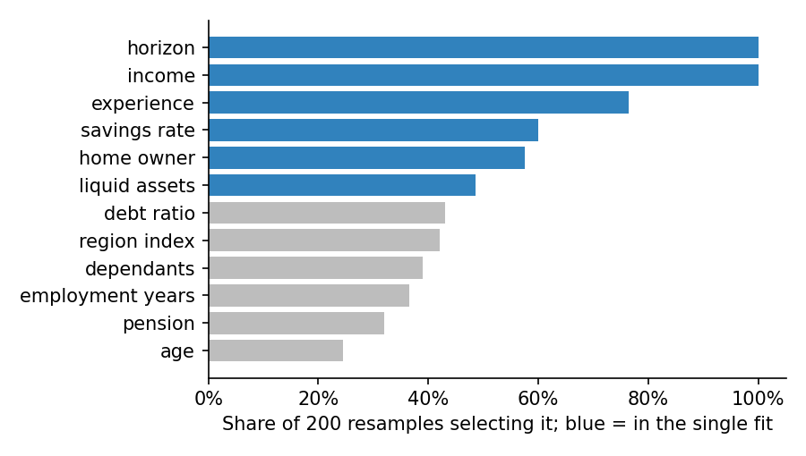

# Statistical rigour

> Public sources only; full references in [SOURCES.md](../SOURCES.md). Every
> number quoted below comes from the simulated data in
> [05-illustrations](../05-illustrations/), not from any real firm.

## Why this lens

Every other lens produces numbers: rates, gaps, intervals, p-values. This one
asks whether those numbers are honest. *The Elements of Statistical Learning*
(Hastie, Tibshirani & Friedman) catalogues the classic ways validation
numbers mislead: choices made on the full dataset leaking into
cross-validation, "important" features that are artefacts of one sample,
error rates that mix up bias and variance, and real findings buried under
chance ones when many tests are run.

A validation suite like this one, with dozens of tests each split by group
and bucket, is exactly where those problems arise. So this lens applies to
the validation itself as much as to the model.

## What I read, and what each source changed

| Source | The idea I took from it | What it changed in the tests |
|---|---|---|
| Hastie et al. (2009), section 7.10.2, *the wrong and right way to do cross-validation* | Any step that uses the outcome (such as feature screening) must be repeated inside each fold. | Re-run every data-driven step inside the folds (S1) |
| Benjamini & Hochberg (1995); Hastie et al. (2009), section 18.7 | Control the false discovery rate when many hypotheses are tested. | FDR control across the whole suite (S2) |
| Hastie et al. (2009), section 3.4; Meinshausen & Bühlmann (2010) | Lasso selection among correlated features is unstable; selection frequency under resampling is more reliable. | Disclosed drivers must be stable under resampling (S3) |
| Hastie et al. (2009), sections 7.3 and 7.6 | Error decomposes into bias, variance and noise; effective degrees of freedom measure how much a model has fitted. | Bias-variance decomposition (S4); complexity against data (S5) |

## The tests

---

### S1. Nested cross-validation

**Principle.** If features, thresholds or tuning are chosen using all the
data, cross-validation afterwards measures how well the model fits data it
has partly seen (Hastie et al., 7.10.2).

**Objective.** Check that the performance reported in model documentation
comes from a procedure in which every data-driven choice was repeated inside
each fold.

**Client harm.** A model is approved on accuracy it does not have.

**Why existing tests miss it.** The cross-validation code is usually correct.
The leak is in the steps before it, which may sit in a different notebook or
team.

**Data.**
- **The full development pipeline,** from raw data to final model, as code
  that can be rerun: cleaning, feature construction, screening, selection,
  tuning and threshold setting.
- **The documented performance figure,** and how it was produced.
- **The development data,** so the pipeline can be rebuilt end to end.

**Method.**
1. **List every step that uses the outcome.** Screening features by their
   correlation with the outcome, choosing among models, tuning settings and
   setting cut-offs all count. Steps that never look at the outcome, such as
   standardising a column, are usually safe.
2. **Rebuild the pipeline so all of them run inside each training fold.**
   The held-out fold must play no part in any choice, only in the final
   scoring. Where tuning is involved, this means a cross-validation inside
   each training fold: "nested" cross-validation.
3. **Compare the nested estimate with the documented one.** A large drop
   means the documented figure measured partly memorised data.
4. **Check for leaks outside the code,** such as a feature list agreed in a
   meeting after someone had looked at all the data.

**Setting the pass criteria.** Pass if the documented performance is the
nested figure, or the gap between the two is explained and immaterial. A
material gap means the documented figure is replaced by the nested one, and
any decision made on it is revisited.

**What the illustration shows.** The script gives 200 simulated clients a
random outcome and 2,000 random features, so no model can do better than
50%. A common shortcut picks the 20 features most related to the outcome
using all the data, then cross-validates a model on those 20.

| Procedure | Reported accuracy |
|---|---|
| Features chosen on all the data, then cross-validated | 76% |
| Feature choice repeated inside each fold | 52% |
| The truth | 50% |

The shortcut reports 76% on pure noise, because the 20 features were chosen
partly for how well they happened to fit the clients later used to test
them. Repeating the choice inside each fold brings the figure back to chance.
The cross-validation code is identical in both; only the place where the
features are chosen differs.
[`s1_nested_cross_validation.py`](../05-illustrations/s1_nested_cross_validation.py)

**Adjacent tests.**
- **D2** is the same kind of leak in time: future information used in a
  past decision.
- **S5** asks whether the model is too flexible for its data, which makes
  any leak worse.
- **F7** keeps choices made after seeing the data out of confirmatory
  results.

**Regulatory hook.** SR 26-2 (outcomes analysis). **NIST AI RMF.** MEASURE 2.5.

---

### S2. Multiple testing across the suite

**Principle.** At p < 0.05, one test in twenty of a true null "fails" by
chance. The false discovery rate controls the share of flagged results that
are false (Benjamini & Hochberg, 1995).

**Objective.** Report pass and fail across the whole suite with the false
discovery rate controlled, so findings can be trusted.

**Client harm.** Real problems are lost among false alarms, or the suite is
dismissed as noisy and real failures are ignored.

**Why existing tests miss it.** Each test is designed and read on its own.
Nobody counts how many were run.

**Data.** Every p-value the validation produces, collected in one table with
the test, group and bucket it came from. This includes tests that came back
clean: leaving them out makes the correction too weak.

**Method.**
1. **Gather all p-values** in one table: every test, every group, every
   bucket, every period.
2. **Apply the Benjamini–Hochberg procedure** at the agreed rate. It ranks
   the p-values and adjusts each one for how many tests were run, giving a
   q-value. Flagging results with q below 5% means that, on average, no more
   than 5% of the flagged results are false alarms.
3. **Report findings from the corrected table only.** Results that are
   significant before correction but not after are kept, but labelled
   exploratory (F7) and followed up on new data.
4. **Group tests sensibly.** Tests that answer separate questions for
   separate audiences can be corrected in separate families, as long as the
   families are fixed before the results are seen.

**Setting the pass criteria.** Agree the false discovery rate and the
families in advance. Pass if every pass or fail statement in the report is
backed by the corrected table.

**What the illustration shows.** The script simulates 300 client segments of
150 to 400 clients each. Most are suitably served 80% of the time; ten are
genuinely worse, at 68%. Each segment is tested for being below 80%.

| Reading | Segments flagged | Real problems | False alarms |
|---|---|---|---|
| Each test at p < 0.05 | 15 | 9 | 6 |
| False discovery rate controlled at 5% | 9 | 9 | 0 |

Reading each test alone flags 15 segments, and 6 of them are noise: two in
five flagged findings would send someone chasing a problem that does not
exist. With the false discovery rate controlled, all 9 flags are real. One of
the ten real problems is missed either way, because its segment happened to
look fine in this sample; correction costs very little here and removes
every false alarm.
[`s2_multiple_testing.py`](../05-illustrations/s2_multiple_testing.py)

**Adjacent tests.**
- **F3** compares many intersectional cells and relies on this correction.
- **F7** labels results that do not survive it as exploratory.
- **P2** applies it when several portfolio rankings are claimed at once.

**Regulatory hook.** SR 26-2 (effective challenge). **NIST AI RMF.** MEASURE 2.13.

---

### S3. Feature-selection stability

**Principle.** When features are correlated, the lasso picks one of a
correlated set somewhat arbitrarily; the choice changes with the sample.
Selection frequency across resamples separates stable drivers from lucky
ones (Meinshausen & Bühlmann, 2010).

**Objective.** Check that any factor described to clients or governance as
"driving" the model is selected consistently under resampling.

**Client harm.** Clients are told their advice depends on factors that a
slightly different dataset would not have chosen. The explanation is not
reliable.

**Why existing tests miss it.** The feature list comes from one fit and is
reviewed for plausibility, not stability.

**Data.**
- **The development data** and the exact selection procedure, with its
  settings (such as the lasso penalty).
- **Every place the selected factors are described:** model documentation,
  client disclosures, explanations of individual recommendations.

**Method.**
1. **Repeat the selection on many bootstrap resamples** (200 here), with the
   same procedure and settings each time.
2. **Record how often each factor is selected.** A factor that really drives
   the outcome should be chosen almost every time.
3. **Compare with the disclosed list:** which disclosed factors are stable,
   and which were chosen by luck in the one fit that was documented.
4. **Look at correlated groups.** Where two factors take turns being
   selected, describe the group, such as "income and liquid assets", rather
   than whichever member happened to win.

**Setting the pass criteria.** Agree a selection frequency in advance (for
example, 80%). Pass if every factor described to clients or governance as a
driver reaches it. Factors below it are removed from the description, or
described as a group with the factors they trade places with.

**What the illustration shows.** The script simulates 300 clients with 12
characteristics. The outcome truly depends on three of them: income and
investment horizon strongly, experience more weakly. Liquid assets are
strongly correlated with income, and age with horizon, but neither has an
effect of its own.

| Factor | In the one documented fit | Selected across 200 resamples |
|---|---|---|
| Income | yes | 100% |
| Horizon | yes | 100% |
| Experience | yes | 76% |
| Savings rate | yes | 60% |
| Home owner | yes | 57% |
| Liquid assets | yes | 48% |
| Six other factors | no | 24–43% |

The one documented fit names six drivers. Only income and horizon are
chosen every time. Experience, a real but weaker effect, comes close.
Savings rate and home ownership have no effect at all, yet the documented fit
included them; they were selected by luck in that sample. Liquid assets
trades places with income, since the two carry much the same information.
Telling clients their advice depends on these six factors would be partly
untrue.

*Blue bars are the six factors in the one documented fit. Only income and
horizon are selected every time. Savings rate and home ownership have no
effect, yet each is selected in about three resamples in five.*

[`s3_selection_stability.py`](../05-illustrations/s3_selection_stability.py)

**Adjacent tests.**
- **U6** asks whether the data supports each input at all; S3 asks whether
  the choice of inputs is stable.
- **O1** checks whether a single input dominates the recommendation.
- **F1** tests the inputs that should never matter.

**Regulatory hook.** Disclosure of how the algorithm works (SEC IM Guidance
2017-02). **NIST AI RMF.** MEASURE 2.9.

---

### S4. Bias-variance decomposition

**Objective.** For each risk band where the model misses its target, find
whether the error comes from the model being systematically wrong (bias),
unstable (variance) or from noise that no model could remove.

**Client harm.** The wrong fix is applied: more data for a model that is
biased, or a more complex model when the problem is instability.

**Why existing tests miss it.** Validation reports the total error. The same
total can come from very different causes, each needing a different remedy.

**Data.** The development data and training procedure, so the model can be
refitted many times, and held-out clients with a reference outcome.

**Method.**
1. **Refit the model on many bootstrap resamples** of the development data.
2. **For each held-out client,** compare the average prediction across refits
   with the reference outcome (the bias) and measure how much the predictions
   vary between refits (the variance), following Hastie et al., 7.3.
3. **Estimate the noise** from the reliability of the reference labels (D7),
   since no model can be more accurate than its labels.
4. **Summarise by risk band** and by client group, since the dominant source
   can differ between them.

**Setting the pass criteria.** Pass if the dominant source of error is
identified for every band that misses its target, and the remediation plan
matches it: a richer model or better inputs for bias, more data or a simpler
model for variance, better labels for noise.

**Adjacent tests.**
- **S5** helps explain high variance: a model too flexible for its data.
- **D7** sets the noise floor from label reliability.

**Regulatory hook.** SR 26-2 (outcomes analysis). **NIST AI RMF.** MEASURE 2.5.

### S5. Effective complexity against data

**Objective.** Check that each part of the model is no more flexible than its
data can support.

**Client harm.** A model too flexible for its data looks good in validation
and disappoints in use.

**Why existing tests miss it.** Complexity is usually judged by the number of
inputs or parameters, which can mislead in both directions: a heavily
regularised model with many parameters may be simple in practice, and a
small model with many interactions may not be.

**Data.** Each model component and its training data, including how many
clients sit in each segment the component treats separately.

**Method.**
1. **Estimate effective degrees of freedom** for each component (Hastie et
   al., 7.6): how much the fitted values move when the outcomes move, which
   measures how much the model has actually fitted.
2. **Compare with the data available,** overall and in each segment the model
   treats separately, since a component can be well supported overall and
   thin in one segment.
3. **Compare training and held-out performance.** A large gap is the usual
   symptom of too much flexibility.

**Setting the pass criteria.** Agree a limit on effective complexity relative
to the data (for example, a minimum number of clients per effective degree
of freedom). Pass if every component is within it, or has a written
justification and a held-out performance check that supports it.

**Adjacent tests.**
- **S1** checks the performance estimate that flexibility can inflate.
- **S4** shows the variance that too much flexibility creates.

**Regulatory hook.** SR 26-2 (conceptual soundness). **NIST AI RMF.** MEASURE 2.5.

## How the tests fit together

S1 and S5 ask whether reported performance is real. S3 and S4 ask whether
what the model is said to do is stable. S2 applies to the whole validation
and should be the last step before any report.
